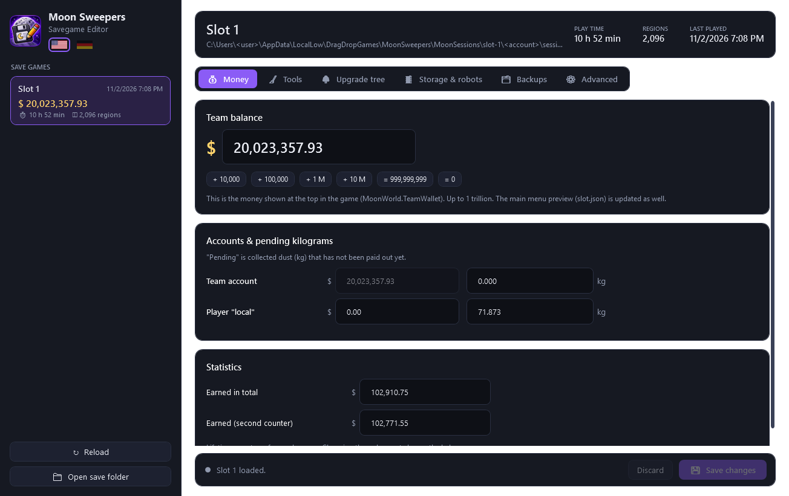
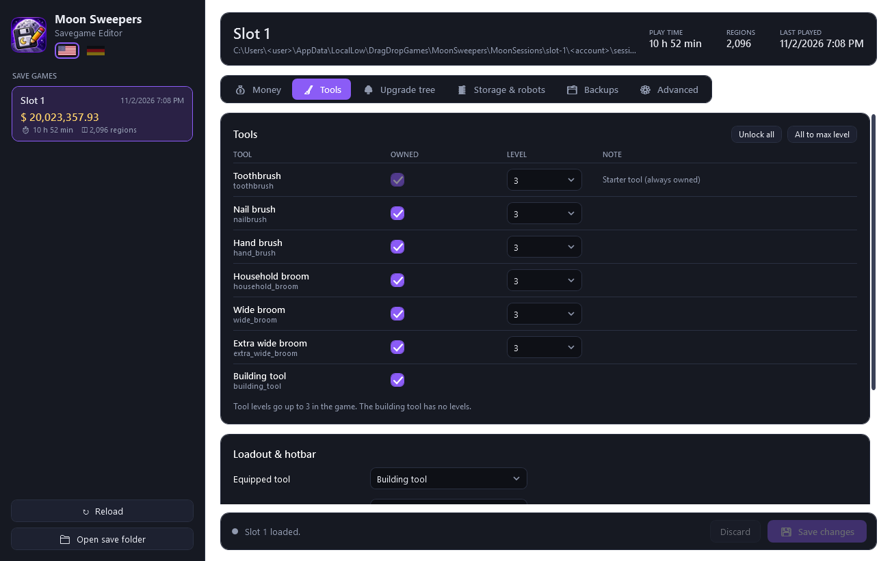
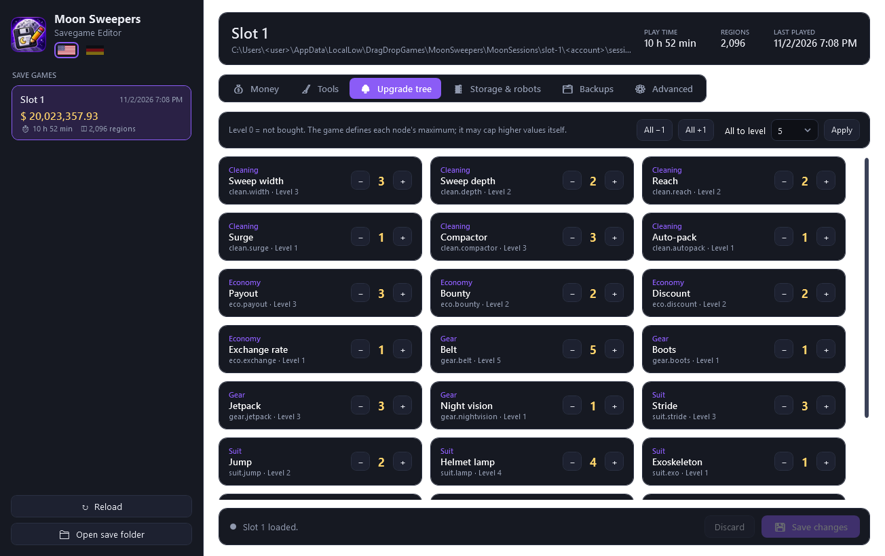
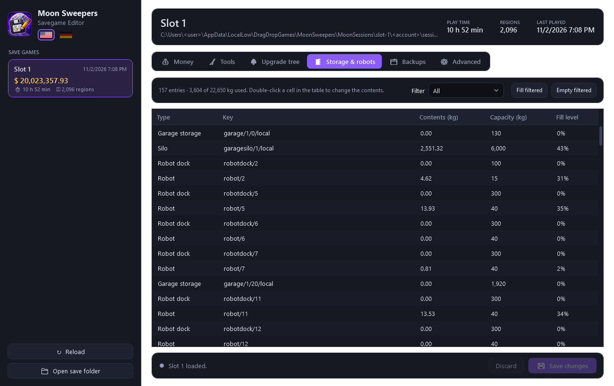

# Moon Sweepers Savegame Editor

Save game editor for **Moon Sweepers** (DragDropGames, Unity IL2CPP, Steam app 5335510). Edits money, tools, the upgrade tree and storage contents, and writes the save so the game accepts it. One self-contained exe with a dark theme, English and German UI.

Unofficial fan tool, not affiliated with DragDropGames.

[](../../releases/latest)
[](../../releases)


[](LICENSE)



## Features

| Tab | What you can change |
|-----|---------------------|
| **Money** | Team balance with quick buttons, other accounts, pending kilograms, lifetime "earned" statistics |
| **Tools** | Own any tool (unlock all), tool levels 1–3, equipped tool, the 6 hotbar slots and the active slot; tools added by mods are shown too |
| **Upgrade tree** | All 22 nodes (cleaning, economy, gear, suit, logistics), one by one or all at once; nodes added by mods are shown too |
| **Storage & robots** | Contents of the silo, garage storage, robots, robot docks and dust catchers; filter, fill, empty |
| **Backups** | Automatic backup before every save, manual backup, restore any backup |
| **Advanced** | Export the decompressed save as `.bin` (hex editing) and import it again |

Also:

- Lists every save slot with balance, regions, play time and last played date, including the slots of the [Mars Sweepers](https://www.nexusmods.com/moonsweepers/mods/148) mod
- Size and SHA256 checksum are recalculated, so the game does not fall back to `session.moon.bak`
- Only writes a save if the edited data parses again; anything the editor does not understand is copied byte for byte
- Refuses to save while the game is running, or when the game wrote the save after the editor loaded it
- English (default) and German, switchable with the flags in the sidebar
- Single exe, no installation, no .NET runtime needed

| Tools | Upgrade tree | Storage & robots |
|-------|--------------|------------------|
|  |  |  |

German UI: [docs/upgrade-tree-de.png](docs/upgrade-tree-de.png)

## Mods

Saves from modded games can be edited. Version 2.1.0 was tested with these mods (Windows 11, Moon Sweepers Steam build 26682829 from 16 November 2026, BepInEx 6.0.0-be.791 with the [MoonSweepers BepInEx Patcher](https://www.nexusmods.com/moonsweepers/mods/9) 1.0.2):

| Mod | Test | Result |
|-----|------|--------|
| [Mars Sweepers](https://www.nexusmods.com/moonsweepers/mods/148) 0.1.1 | Mars slots listed as "Mars · Slot N", values changed in the editor, save loaded in the game | ✅ works |
| [Belt Overdrive](https://www.nexusmods.com/moonsweepers/mods/35) 1.0.1 | Upgrade `mod.belt.speed` shown with the MOD tag, level changed in the editor, new belt speed active in the game | ✅ works |
| [Titan Broom](https://www.nexusmods.com/moonsweepers/mods/92) 1.0.0 | Tool `titan_broom` bought in the game, shown with the MOD tag, removed in the editor, gone in the game | ✅ works |

How mods are handled:

- Tools and upgrades that a mod adds get a yellow **MOD** tag. Their id is shown as the name, because the editor cannot know the mod's display name.
- Their levels stay exactly as saved unless you change them yourself. "Unlock all", "All to max level" and the "All …" buttons of the upgrade tree only touch the game's own tools and nodes; the maximum level of a mod upgrade is set by the mod.
- **Mars Sweepers** links its `mars-production.json` to the SHA256 of the save and refuses a save that does not match ("production file does not match this save"). The editor updates that link when it saves, and backs up and restores the file together with the save. Backups of Mars slots go to `EditorBackups\mars-slot-N`.
- Other mods should work as long as they store their data like the game does. If a save cannot be opened, the error names the section where reading stopped; please [open an issue](../../issues) with that line and the list of your mods.

## Usage

1. Download `MoonSweeperEditor.exe` from the [latest release](../../releases/latest) (Windows 10/11 x64). If your antivirus deletes it, see [Antivirus deleted or blocked the exe](#antivirus-deleted-or-blocked-the-exe).
2. Close the game.
3. Start the editor, pick a slot, change what you want, click **Save changes**.

Before every save the editor copies the slot to `%USERPROFILE%\AppData\LocalLow\DragDropGames\MoonSweepers\EditorBackups\`. The **Backups** tab restores any of them. Backups made by version 1.x are listed there too.

Notes:

- Tool levels go up to 3. The game defines the maximum level of each upgrade-tree node; the editor allows 0–10 and the game may cap higher values itself.
- Vehicles are not editable yet.
- `slot.json` is only the main-menu preview. The editor updates its `dollars`; play time there is overwritten by the game.

## Antivirus deleted or blocked the exe

Some antivirus programs quarantine or delete `MoonSweeperEditor.exe` right after the download or on the first start. This is a **false positive**. Typical names are `Trojan:Win32/Wacatac.B!ml`, `IDP.Generic` or `Gen:Variant…`; the `!ml` / `Generic` part means a machine-learning guess, not a known virus.

Why it happens:

- The exe is not code-signed (a certificate costs money every year).
- It is a new file with few downloads, so it has no "reputation" yet.
- It is a self-contained single-file .NET app with compressed contents. To a heuristic scanner that looks similar to a packed program.

Check it yourself:

- [VirusTotal scan of `MoonSweeperEditor.exe` v2.0.0](https://www.virustotal.com/gui/file/c067c3b687ac149f83a447c4c69465a7338470590b0f1a633d0c6b96ae8a375c/detection): 0 of 69 scanners flagged it (November 2026).
- Compare the SHA256 with the one in the [release notes](../../releases/latest). In PowerShell: `Get-FileHash .\MoonSweeperEditor.exe`
- Or don't trust the exe at all and [build it yourself](#build) from this source code.

Get the file back:

- **Windows Defender:** Windows Security → Virus & threat protection → **Protection history** → click the entry → Actions → **Restore**. To stop it from happening again: Virus & threat protection settings → **Exclusions** → Add an exclusion → Folder → pick the editor's folder.
- **Other antivirus (Avast, AVG, Norton, Bitdefender, Kaspersky …):** open its quarantine (sometimes called "virus chest"), restore the file and add an exception for it or its folder.
- **"Windows protected your PC"** (SmartScreen, blue window): click **More info → Run anyway**. That is only a warning, nothing is deleted.

Only exclude this one file or folder. Do not turn your antivirus off.

You can help: report the false positive to your antivirus vendor, for Windows Defender at <https://www.microsoft.com/en-us/wdsi/filesubmission> ("Incorrectly detected as malware"). Every report makes it less likely for the next user.

<details>
<summary>🇩🇪 Deutsch: Antivirus hat die exe gelöscht oder blockiert</summary>

Manche Virenscanner löschen `MoonSweeperEditor.exe` direkt nach dem Download oder beim ersten Start oder schieben sie in die Quarantäne. Das ist ein **Fehlalarm**: Die exe ist nicht signiert, noch neu (wenig Downloads) und eine gepackte .NET-Einzeldatei. Bei [VirusTotal](https://www.virustotal.com/gui/file/c067c3b687ac149f83a447c4c69465a7338470590b0f1a633d0c6b96ae8a375c/detection) meldet keiner der 69 Scanner etwas.

- **Windows Defender:** Windows-Sicherheit → Viren- & Bedrohungsschutz → **Schutzverlauf** → Eintrag anklicken → Aktionen → **Wiederherstellen**. Danach unter Einstellungen für Viren- & Bedrohungsschutz → **Ausschlüsse** → Ausschluss hinzufügen → Ordner → den Ordner des Editors wählen.
- **Andere Virenscanner:** Quarantäne öffnen, Datei wiederherstellen, Ausnahme für die Datei oder den Ordner anlegen.
- **„Der Computer wurde durch Windows geschützt“:** **Weitere Informationen → Trotzdem ausführen**.

Nur diese eine Datei bzw. diesen Ordner ausnehmen, den Virenschutz nicht ausschalten. Wer der exe nicht traut, kann sie aus dem Quellcode selbst bauen (siehe [Build](#build)).

</details>

## Linux

A separate Linux build, made on request of a user. The automatic backups work the same way as on Windows.

| Version | Linux status |
|---------|--------------|
| 2.1.0 | ☐ **not tested yet**: same code as the tested Windows build and the automated Linux UI test passes, but nobody has tried it on a real Linux system |
| 2.0.1 | ☑ works, reported by Linux players on Steam |

**Please report back.** If you use the editor on Linux (or a Steam Deck), [fill in the short Linux test report](../../issues/new?template=linux-test-report.yml), also when everything works. Once a report confirms 2.1.0, the box above gets ticked.

1. Download `MoonSweeperEditor-linux-x64.tar.gz` from the [latest release](../../releases/latest).
2. Close the game, then:
   ```
   tar -xzf MoonSweeperEditor-linux-x64.tar.gz
   ./MoonSweeperEditor
   ```

- x86-64 desktop Linux (X11 or XWayland); the Steam Deck in desktop mode should work too. Uses the usual desktop libraries (fontconfig, ICU).
- Moon Sweepers is a Windows game, so on Linux it runs through Steam Play (Proton) and saves into its Wine prefix. The editor searches every Steam library (normal, Flatpak and Snap Steam) for
  `steamapps/compatdata/5335510/pfx/drive_c/users/steamuser/AppData/LocalLow/DragDropGames/MoonSweepers`.
  If it finds nothing, click **Choose save folder …** in the sidebar and select the `MoonSweepers` folder; the choice is remembered.
- Same tabs and functions as the Windows build. The UI is made with Avalonia instead of WPF, so it looks slightly different, and the emoji icons are left out.
- Settings are stored in `~/.config/MoonSweeperEditor/settings.json`.

## Save format

Saves live in `%USERPROFILE%\AppData\LocalLow\DragDropGames\MoonSweepers\MoonSessions\slot-N\<account hash>\session.moon` (Mars Sweepers mod: `...\MoonSweepers\MarsSweepers\Release\saves\slot-N\<account hash>\session.moon`, same format):

```
"1PCM" | uint32 rawSize | byte 0x40 | 64 hex chars = SHA256(raw) | gzip(raw)
```

The decompressed data is written with .NET `BinaryWriter` (7-bit length-prefixed UTF-8 strings, decimals as lo/mid/hi/flags). After the terrain and region data comes the player block the editor works on:

```
stats        bool 1, double earned, int32 n × (string player, double), double earned
wallet       int32 n × (string owner, decimal dollars, decimal pendingKilograms)
inventories  int32 n × (string owner, int32, int32 m × (string tool, int32))
piles        int32 nextId, int32 n × (int32, string, 57 bytes)
buildings    int32 nextId, int32 n × (int32, string, 32 bytes)
hotbars      int32 n × (string owner, int32 selected, int32 m × string tool)
canisters    int32 n × (string key, double amount, double capacity)
conveyors    int32 nextId, int32 n × (int32, string, 48 bytes, byte k, k × 24 bytes, byte)
             k = extra points of a belt with bends (0 for straight belts); before the game update of 2026-11-16 only the 48 bytes
rotations    int32 n × 24 bytes, int32, int32
tool levels  int32 n × (string owner, string equipped, int32 m × (string tool, int32 level, double))   sorted by tool id
tree         int32 n × (string owner, int32 m × (string node, int32 level))
```

Tool and node ids are short ASCII names: the game uses e.g. `nailbrush` or `logi.transfer`, mods add their own such as `titan_broom` or `mod.belt.speed`. Everything before and after the block (terrain, robots, scores, landmarks) is kept unchanged. Offsets move between saves, so the block is located through the `team` wallet entry, and a match only counts if it re-serializes byte for byte ([Core/SessionData.cs](src/MoonSweeperEditor/Core/SessionData.cs)). The ids of tools and upgrade nodes come from the string literals in `global-metadata.dat` ([Core/GameData.cs](src/MoonSweeperEditor/Core/GameData.cs)).

## Build

```
cd src/MoonSweeperEditor
dotnet publish -c Release -o ../../publish
```

Self-test, read-only on the given folders (parse, byte-identical round trip, edit + re-encode in memory):

```
cd tests/SelfTest
dotnet run -c Release -- "%USERPROFILE%\AppData\LocalLow\DragDropGames\MoonSweepers"
```

`dotnet run -c Release -- --e2e <folder>` exercises the write path (backup, write, stale-save check, restore). Only run it on a **copy** of the save folder.

Linux build (single file, self-contained):

```
dotnet publish src/MoonSweeperEditor.Linux -c Release -r linux-x64 -o publish/linux
```

Without `-r` it builds for the current OS, so the Linux UI can be tried on Windows too. `tests/LinuxUiTest` drives that UI headless on a **copy** of the save folder (edit, save, check the file): `dotnet run -- <copy of the MoonSweepers folder>`.

Command-line options of the editor, mainly for testing and screenshots:

| Option | Effect |
|--------|--------|
| `--root <folder>` | Use another MoonSweepers data folder (e.g. a copy) |
| `--lang en\|de` | Language for this run |
| `--mask-user` | Hide the Windows user name and the account folder in displayed paths |
| `--snapshot <folder>` | Render every tab to PNG and exit |

## Layout

| Path | Purpose |
|------|---------|
| `src/MoonSweeperEditor/Core/MoonContainer.cs` | Read/write the 1PCM container |
| `src/MoonSweeperEditor/Core/SessionData.cs` | Locate, parse and rebuild the player block |
| `src/MoonSweeperEditor/Core/SaveSlot.cs`, `SaveStore.cs` | Slots, `slot.json`, backups, safe writing |
| `src/MoonSweeperEditor/Core/GameData.cs`, `Loc.cs` | Tool/node ids and names, English/German texts |
| `src/MoonSweeperEditor/MainWindow.xaml` | UI; `Themes/` holds the dark theme and the flags |
| `src/MoonSweeperEditor.Linux` | Linux build (Avalonia UI, save folder search under Proton); uses the same `Core/` |
| `tests/SelfTest` | Parser and write-path checks |
| `tests/LinuxUiTest` | Headless test of the Linux UI on a save copy |

See [CHANGELOG.md](CHANGELOG.md) for what changed since 1.0.

## License

MIT, see [LICENSE](LICENSE).
