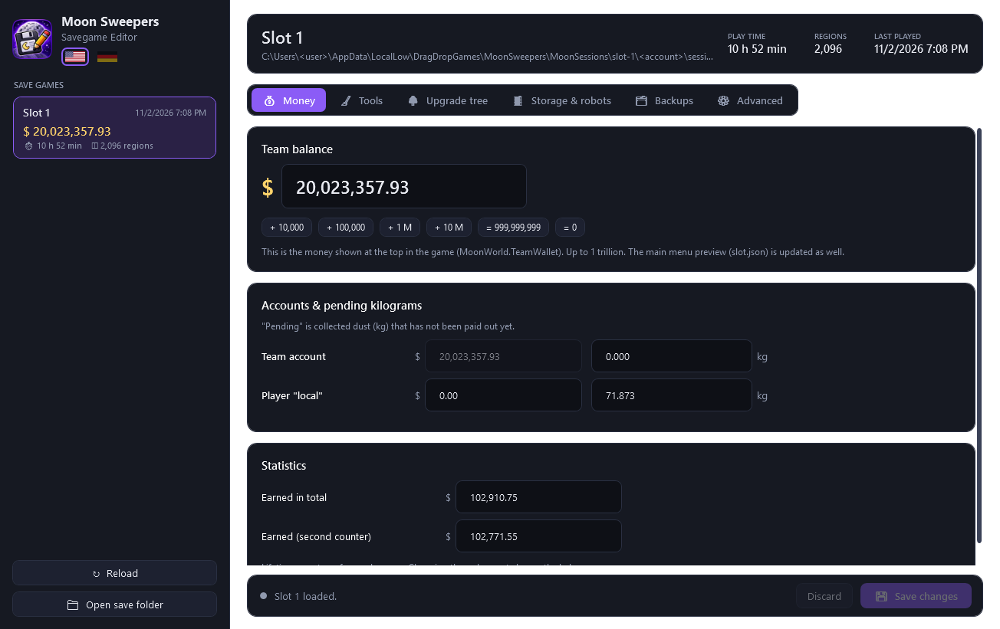
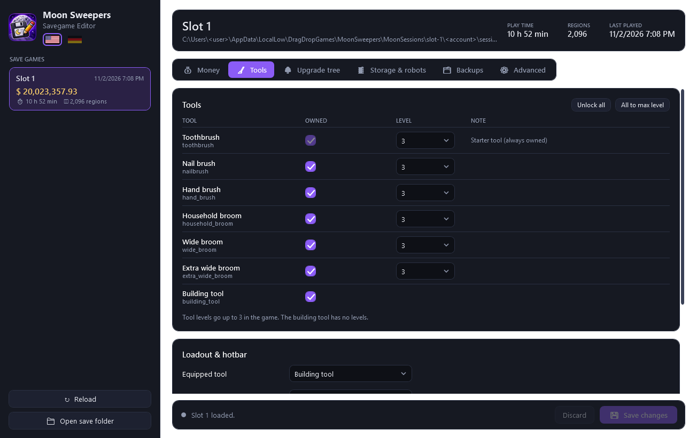
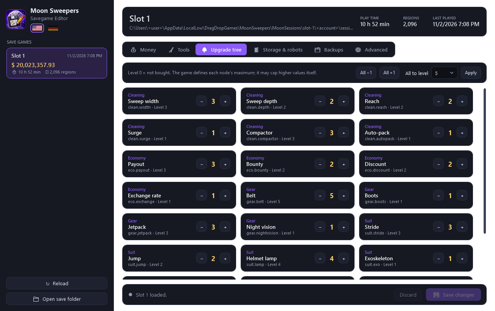
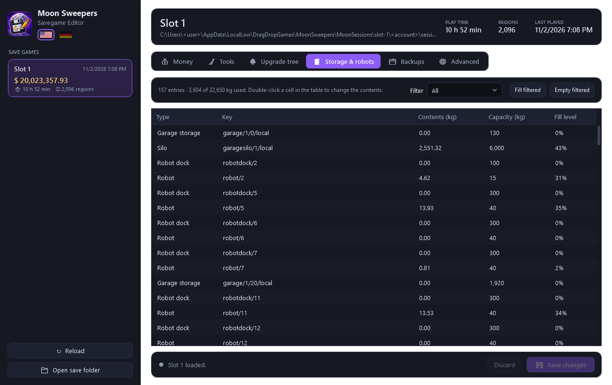

# Moon Sweepers Savegame Editor

Save game editor for **Moon Sweepers** (DragDropGames, Unity IL2CPP, Steam app 5335510). Edits money, tools, the upgrade tree and storage contents, and writes the save so the game accepts it. One self-contained exe with a dark theme, English and German UI.

Unofficial fan tool, not affiliated with DragDropGames.

[](../../releases/latest)
[](../../releases)

[](LICENSE)



## Features

| Tab | What you can change |
|-----|---------------------|
| **Money** | Team balance with quick buttons, other accounts, pending kilograms, lifetime "earned" statistics |
| **Tools** | Own any tool (unlock all), tool levels 1–3, equipped tool, the 6 hotbar slots and the active slot |
| **Upgrade tree** | All 22 nodes (cleaning, economy, gear, suit, logistics), one by one or all at once |
| **Storage & robots** | Contents of the silo, garage storage, robots, robot docks and dust catchers; filter, fill, empty |
| **Backups** | Automatic backup before every save, manual backup, restore any backup |
| **Advanced** | Export the decompressed save as `.bin` (hex editing) and import it again |

Also:

- Lists every save slot with balance, regions, play time and last played date
- Size and SHA256 checksum are recalculated, so the game does not fall back to `session.moon.bak`
- Only writes a save if the edited data parses again; anything the editor does not understand is copied byte for byte
- Refuses to save while the game is running, or when the game wrote the save after the editor loaded it
- English (default) and German, switchable with the flags in the sidebar
- Single exe, no installation, no .NET runtime needed

| Tools | Upgrade tree | Storage & robots |
|-------|--------------|------------------|
|  |  |  |

German UI: [docs/upgrade-tree-de.png](docs/upgrade-tree-de.png)

## Usage

1. Download `MoonSweeperEditor.exe` from the [latest release](../../releases/latest) (Windows 10/11 x64).
2. Close the game.
3. Start the editor, pick a slot, change what you want, click **Save changes**.

Before every save the editor copies the slot to `%USERPROFILE%\AppData\LocalLow\DragDropGames\MoonSweepers\EditorBackups\`. The **Backups** tab restores any of them. Backups made by version 1.x are listed there too.

Notes:

- Tool levels go up to 3. The game defines the maximum level of each upgrade-tree node; the editor allows 0–10 and the game may cap higher values itself.
- Vehicles are not editable yet.
- `slot.json` is only the main-menu preview. The editor updates its `dollars`; play time there is overwritten by the game.

## Save format

Saves live in `%USERPROFILE%\AppData\LocalLow\DragDropGames\MoonSweepers\MoonSessions\slot-N\<account hash>\session.moon`:

```
"1PCM" | uint32 rawSize | byte 0x40 | 64 hex chars = SHA256(raw) | gzip(raw)
```

The decompressed data is written with .NET `BinaryWriter` (7-bit length-prefixed UTF-8 strings, decimals as lo/mid/hi/flags). After the terrain and region data comes the player block the editor works on:

```
stats        bool 1, double earned, int32 n × (string player, double), double earned
wallet       int32 n × (string owner, decimal dollars, decimal pendingKilograms)
inventories  int32 n × (string owner, int32, int32 m × (string tool, int32))
piles        int32 nextId, int32 n × (int32, string, 57 bytes)
buildings    int32 nextId, int32 n × (int32, string, 32 bytes)
hotbars      int32 n × (string owner, int32 selected, int32 m × string tool)
canisters    int32 n × (string key, double amount, double capacity)
conveyors    int32 nextId, int32 n × (int32, string, 48 bytes)
rotations    int32 n × 24 bytes, int32, int32
tool levels  int32 n × (string owner, string equipped, int32 m × (string tool, int32 level, double))   sorted by tool id
tree         int32 n × (string owner, int32 m × (string node, int32 level))
```

Everything before and after the block (terrain, robots, scores, landmarks) is kept unchanged. Offsets move between saves, so the block is located through the `team` wallet entry, and a match only counts if it re-serializes byte for byte ([Core/SessionData.cs](src/MoonSweeperEditor/Core/SessionData.cs)). The ids of tools and upgrade nodes come from the string literals in `global-metadata.dat` ([Core/GameData.cs](src/MoonSweeperEditor/Core/GameData.cs)).

## Build

```
cd src/MoonSweeperEditor
dotnet publish -c Release -o ../../publish
```

Self-test, read-only on the given folders (parse, byte-identical round trip, edit + re-encode in memory):

```
cd tests/SelfTest
dotnet run -c Release -- "%USERPROFILE%\AppData\LocalLow\DragDropGames\MoonSweepers"
```

`dotnet run -c Release -- --e2e <folder>` exercises the write path (backup, write, stale-save check, restore). Only run it on a **copy** of the save folder.

Command-line options of the editor, mainly for testing and screenshots:

| Option | Effect |
|--------|--------|
| `--root <folder>` | Use another MoonSweepers data folder (e.g. a copy) |
| `--lang en\|de` | Language for this run |
| `--mask-user` | Hide the Windows user name and the account folder in displayed paths |
| `--snapshot <folder>` | Render every tab to PNG and exit |

## Layout

| Path | Purpose |
|------|---------|
| `src/MoonSweeperEditor/Core/MoonContainer.cs` | Read/write the 1PCM container |
| `src/MoonSweeperEditor/Core/SessionData.cs` | Locate, parse and rebuild the player block |
| `src/MoonSweeperEditor/Core/SaveSlot.cs`, `SaveStore.cs` | Slots, `slot.json`, backups, safe writing |
| `src/MoonSweeperEditor/Core/GameData.cs`, `Loc.cs` | Tool/node ids and names, English/German texts |
| `src/MoonSweeperEditor/MainWindow.xaml` | UI; `Themes/` holds the dark theme and the flags |
| `tests/SelfTest` | Parser and write-path checks |

See [CHANGELOG.md](CHANGELOG.md) for what changed since 1.0.

## License

MIT, see [LICENSE](LICENSE).
